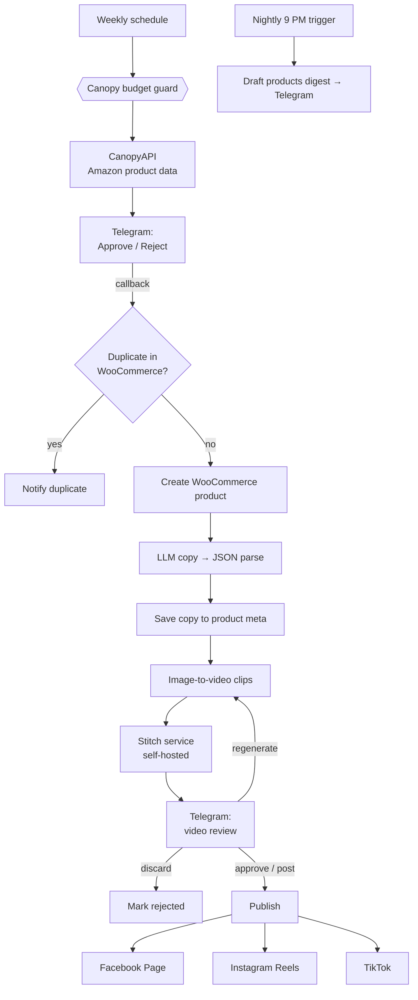

# Gears Garage — AI Product & Content Pipeline (n8n)

An automated pipeline that sources automotive accessories from Amazon, publishes them to a WooCommerce store, generates AI marketing copy and short promo videos, and posts them to Facebook, Instagram and TikTok. A human approves or rejects each step from Telegram.

It runs in production for **[gearsgarages.com](https://gearsgarages.com)**, an Amazon Associates store for automotive accessories, on a self-hosted n8n instance on AWS Lightsail.

> **About this repository:** I built and ran this workflow directly on the server before I was keeping it in version control. I published it here later as documentation and a portfolio piece. API keys, server addresses and account IDs have been replaced with `{{PLACEHOLDERS}}`.

---

## What it does

| Stage | What happens |
|---|---|
| **1. Product discovery** | A weekly schedule checks a curated list of Amazon ASINs through **CanopyAPI** (title, brand, price, rating, images) and sends each candidate to Telegram with **Approve / Reject** buttons. |
| **2. Human approval** | A Telegram callback trigger handles the button press. The workflow looks for the product in WooCommerce first and **blocks duplicates** before doing anything else. |
| **3. Store listing** | Approved products are re-fetched and created in **WooCommerce** as drafts with an affiliate link. |
| **4. AI copywriting** | An LLM (via Pollinations) returns **strict JSON**: review title, 150–200 word review, plus Instagram, TikTok and Facebook captions. A defensive parser handles malformed model output and falls back safely, so one bad AI response doesn't break the run. |
| **5. AI video** | Builds scene prompts from the real product image, generates clips with an image-to-video model, and sends them to a **self-hosted stitching service** that joins them and burns in captions. |
| **6. Video review loop** | The finished video goes to Telegram with **Regenerate / Discard / Approve / Post** actions. Each action updates the product's metadata in WooCommerce and cleans up the chat. |
| **7. Social publishing** | On "Post": **Facebook Graph API** (Page video), **Instagram Reels** (container → wait for processing → publish), and the **TikTok Content Posting API** (init → chunked upload → status check). |
| **8. Nightly digest** | Every night at 9 PM, a Telegram summary lists draft products and their content/video status. |

## Architecture



## Design decisions

- **Human in the loop at the points that matter.** Automation does the repetitive work; a person approves the product before it's listed and the video before it's published. AI output is never posted without review.
- **Idempotency.** A duplicate check on every approval keeps a double-tap or a re-sent message from creating the same product twice.
- **Cost guardrails in code.** A monthly request counter in workflow static data caps CanopyAPI usage (≈590 calls, about $5/month) and stops cleanly with a clear error when the cap is reached. I moved video generation to a cheaper model to keep the whole pipeline around **$5/month**.
- **Defensive handling of LLM output.** The model is asked for JSON. The parser accepts several response shapes, pulls JSON out of extra text, and falls back to a safe default.
- **State lives in WooCommerce.** Captions, `video_url`, `video_ready` and similar fields are stored as product metadata, so the store is the single source of truth and the nightly digest can report from it.
- **Async APIs handled with waits and status checks** for Instagram and TikTok media processing.

## Tech stack

**n8n** (self-hosted, AWS Lightsail) · **JavaScript** (Code nodes) · **WooCommerce REST API** · **CanopyAPI** (Amazon data) · **Telegram Bot API** (triggers, inline buttons, callbacks) · **Pollinations** (LLM text + image-to-video) · **Meta Graph API** (Facebook, Instagram) · **TikTok Content Posting API** · custom **video stitching service** (HTTP API) · Supabase / PostgreSQL and MySQL for product data modeling

## Repository contents

```
workflow.json   # n8n workflow export (sanitized)
README.md
```

## Running it yourself

1. Import `workflow.json` into n8n (**Workflows → Import from file**).
2. Create n8n credentials for: Telegram API, WooCommerce API, Pollinations (Bearer), Meta Graph (query auth) and TikTok (header auth).
3. Replace the placeholders: `{{CANOPY_API_KEY}}`, `{{STITCH_SERVER_URL}}`, `{{STITCH_API_KEY}}`, `{{TELEGRAM_CHAT_ID}}`, `{{FB_PAGE_ID}}`, `{{IG_USER_ID}}`. Keep keys in n8n credentials rather than in node parameters.
4. Edit the ASIN list in the first Code node and activate the workflow.

## Possible improvements

- Move the remaining hard-coded API headers into n8n credentials.
- Put the stitching service behind HTTPS and an IP allowlist.
- Add an error-handler workflow that sends failures to Telegram.

---

**Author:** Junior Gomez · [LinkedIn](https://linkedin.com/in/junior-gomez-32b78674)
